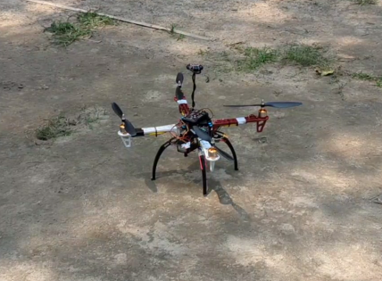
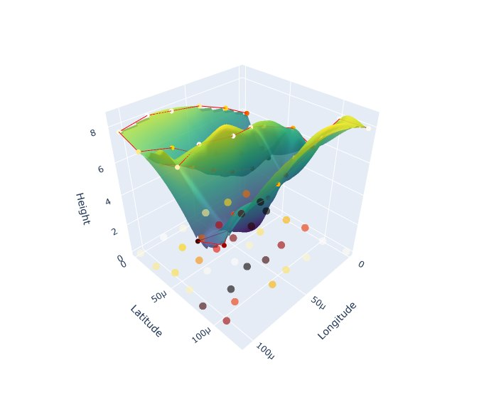
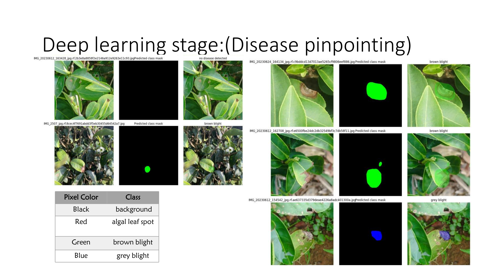
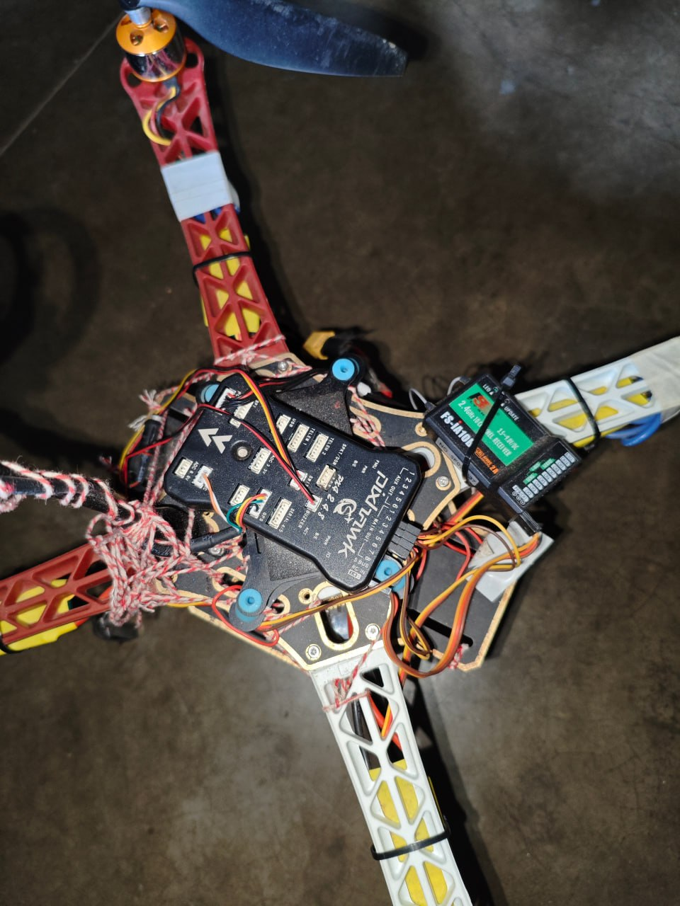

# UAV-Based Vegetation Stress Mapping and Tea Leaf Disease Analysis

EEE 404 Robotics and Automation Laboratory — group project, BUET.

This repository brings together **three complementary components** of a UAV-based tea-garden monitoring concept: RGB vegetation-index analysis from UAV imagery, SegFormer-based disease-region segmentation, and ResNet50-based image-level tea-leaf disease classification. The experiments were developed as components of the same group project; **the code does not demonstrate a fully autonomous, end-to-end flight-to-diagnosis deployment**.



## Project components

| Component | Method | What it produces | Implementation |
|---|---|---|---|
| UAV RGB vegetation analysis | Excess Green (ExG), VARI, low-index visualization | RGB comparisons, heatmaps, illustrative maps | [`notebooks/vegetation_mapping.ipynb`](notebooks/vegetation_mapping.ipynb), [`scripts/vegetation_mapping.py`](scripts/vegetation_mapping.py) |
| Disease-region segmentation | SegFormer-B0, four classes including background | Pixel-level masks and lesion overlays | [`notebooks/segformer_tea_leaf_segmentation.ipynb`](notebooks/segformer_tea_leaf_segmentation.ipynb) |
| Tea-leaf disease classification | ImageNet-pretrained ResNet50, seven classes | Image-level disease labels | [`notebooks/resnet50_tea_leaf_classification.ipynb`](notebooks/resnet50_tea_leaf_classification.ipynb) |

## UAV imagery and vegetation-index mapping

The UAV video-processing workflow extracts RGB frames and computes ExG = 2G − R − B and VARI = (G − R)/(G + R − B), with appropriate numerical safeguards in the cleaned code. Low vegetation-index values identify **potential areas for closer inspection**, not clinically or agronomically verified plant disease.


The original mapping experiment used **synthetic pseudo-GPS coordinates** for a simulated serpentine flight path. The following 3D map is an illustrative visualization, **not** a GPS-validated georeferenced orthomosaic or a measured 3D terrain reconstruction.



## SegFormer — pixel-level disease segmentation

The uploaded training code uses the pretrained **`nvidia/segformer-b0-finetuned-ade-512-512`** checkpoint and predicts four classes: background, algal leaf spot, brown blight, and grey blight. Its configuration is 512×512 images, batch size 4, up to 25 epochs, learning rate 2e-5, and AdamW. It selects the best checkpoint by validation mean Dice and saves predicted masks and overlays.



The team presentation reports **97.7% pixel accuracy and 0.685 average Dice** for its SegFormer experiment. 
## ResNet50 — image-level tea-leaf disease classification

The original Kaggle training code uses a TorchVision **ResNet50 pretrained on ImageNet**, replacing its final layer for the dataset's seven classes: tea algal leaf spot, brown blight, gray blight, helopeltis, red spider, green mirid bug, and healthy leaf. The dataset is **teaLeafBD**. The code implements a stratified 70/15/15 split, 224×224 inputs, batch size 32, class-weighted cross-entropy, AdamW (3e-4), cosine annealing, mixed precision, early stopping, and confusion-matrix evaluation.

The team report gives **93.18% test accuracy** and **0.9309 weighted F1** on its classification evaluation. These figures come from the report; the notebook was reorganized and syntax checked, **not rerun against the dataset here**. The SegFormer and ResNet50 metrics describe **different datasets and tasks** and are not directly comparable.

## Flight documentation




- [UAV project video (compressed MP4)](videos/uav-project-video.mp4)
- [Drone landing video (MP4)](videos/drone-landing.mp4)
- [Additional drone flight video (MP4)](videos/drone-flight.mp4)

## Repository structure

```text
notebooks/
  vegetation_mapping.ipynb
  segformer_tea_leaf_segmentation.ipynb
  resnet50_tea_leaf_classification.ipynb
scripts/
  vegetation_mapping.py
images/
  drone-hardware.png
  drone-flight-photo.png
  exg-vari-comparison.png
  extracted-frames.png
  3d-mapping.png
  segformer-prediction-examples.png
videos/
  uav-project-video.mp4
  drone-landing.mp4
  drone-flight.mp4
data/
  .gitkeep
README.md
requirements.txt
.gitignore
```

## Running the code

Install dependencies:

```bash
pip install -r requirements.txt
python scripts/vegetation_mapping.py --help
```

For **SegFormer**, open its notebook and update the `ROOT` dataset path; the code expects `train/`, `valid/`, and `test/` directories with matching image and `<stem>_mask.png` files. For **ResNet50**, update `BASE_CANDIDATES` to point to the extracted teaLeafBD dataset. The notebooks may require adjustments for newer PyTorch/Transformers versions.

**Reproducibility notes:** Original training datasets, checkpoints, and exact evaluation logs are not distributed here. Some figures are taken from the group's presentation. No claim is made that the proposed UAV revisit and automated diagnosis stages were tested as one integrated system. This was a group project; the presence of project media does not imply individual ownership of all UAV hardware work.
