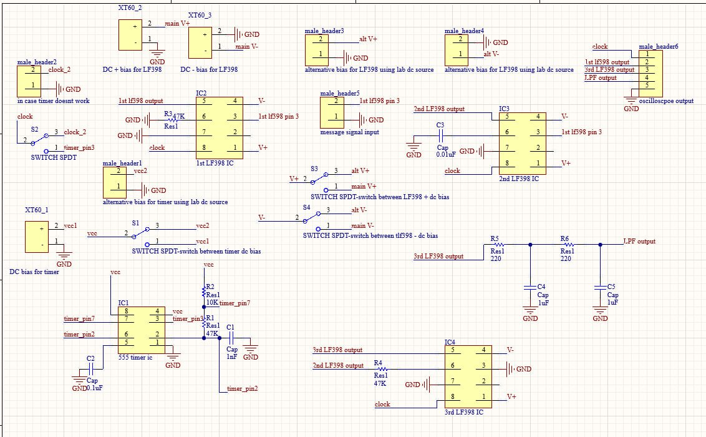
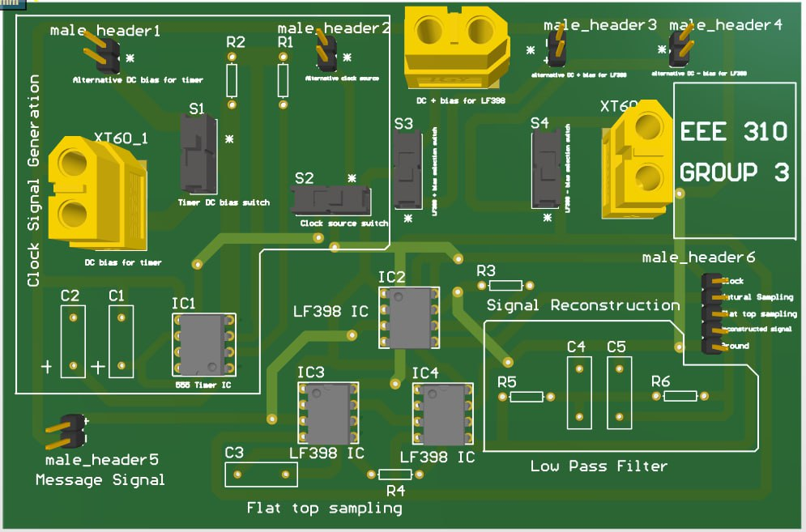
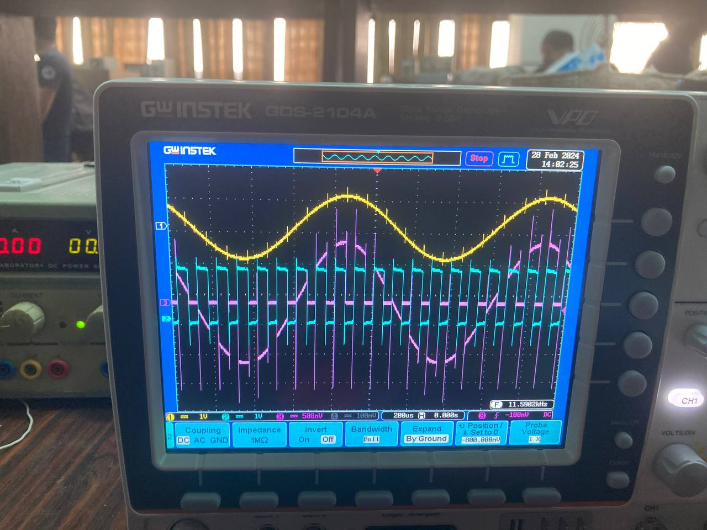

# Signal Sampling and Reconstruction — Custom PCB

**EEE 310 Communication Laboratory | BUET | 2024**  
**My contribution:** PCB design, hardware implementation, equipment procurement, cost management, and report writing.  
**Project type:** Seven-member team laboratory project.


## Overview

This project demonstrates **natural sampling**, **flat-top sampling**, and **analog signal reconstruction**. Our team explored MOSFET-based sampling on breadboards and an LF398 sample-and-hold approach on a custom PCB. I designed the PCB in **Altium Designer** and contributed to its hardware implementation.

The PCB integrates a **555 timer clock generator**, **LF398 sampling ICs**, a **passive low-pass reconstruction filter**, and connectors/switches for choosing clock and DC-bias sources. Outputs are exposed for oscilloscope inspection.

## PCB design and implementation

| Fabricated PCB | 3D PCB layout |
|---|---|
|  |  |

### Schematic






## Circuit blocks

1. **Clock generation:** 555 timer in astable mode, with an approximately **13.875 kHz** design frequency according to the project report. An external lab clock can also be selected.
2. **Sampling:** LF398 sample-and-hold ICs used to demonstrate natural and flat-top sampling; the team also evaluated MOSFET-based sampling on breadboards.
3. **Reconstruction:** A two-stage passive RC low-pass network, using **220 Ω** resistors and **1 µF** capacitors in the reported design.
4. **Instrumentation:** Test connections for clock, sampled outputs, and reconstructed output, along with selectable supply/bias arrangements.

The MOSFET flat-top implementation distorted the negative portion of the signal, motivating the LF398-based PCB implementation.

## Experimental demonstration



 The PCB implementation provided more stable sampled waveforms than the breadboard implementation. 

## Tools and topics

- **PCB design:** Altium Designer
- **Analog electronics:** 555 timer, LF398 sample-and-hold ICs, RC low-pass filtering
- **Signal processing:** Nyquist sampling criterion, natural sampling, flat-top sampling, reconstruction
- **Validation:** Oscilloscope measurements and laboratory hardware tests

## My role and team credit

I was responsible for **PCB design** and also contributed to **hardware implementation, purchasing equipment, cost management, and writing the report**. The circuit design, simulation, debugging, theoretical analysis, and other aspects of the complete laboratory project were collaborative work by the seven-member EEE 310 group at BUET (2024).

## Repository contents

```text
signal-sampling-reconstruction-pcb/
├── README.md
└── images/
    ├── pcb.jpg                 # Fabricated and assembled board
    ├── sampler_pcb.jpg         # 3D PCB layout
    ├── sampler_schematc.jpg    # Schematic
    ├── samplerschematic.jpg    # Additional 3D board render
    └── signal.jpg              # Oscilloscope demonstration
```

> **Note:** The supplied images document the design and tests. Native Altium project files are not included because they were not provided. The original group report is also not included to avoid publishing classmates' student IDs and signatures without review.
