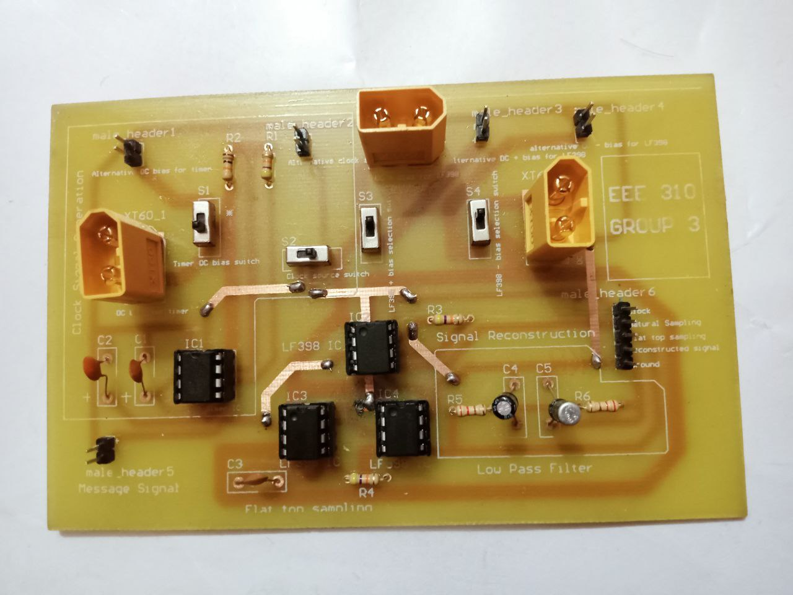

# Signal Sampling and Reconstruction — Custom PCB


## Overview

This project involved designing and implementing a PCB for natural sampling, flat-top sampling, and reconstruction of analog signals.

The circuit uses a 555 timer for clock generation, LF398 sample-and-hold ICs for sampling, and a passive RC low-pass filter for signal reconstruction. The PCB was designed in Altium Designer and tested using laboratory equipment.

MOSFET-based sampling circuits were also implemented on breadboards to compare their performance with the LF398-based circuit.

## PCB Design

The PCB includes the clock generation circuit, sampling stages, reconstruction filter, and connectors for external signal inputs and outputs. Switches were included to select between different clock and DC-bias sources.

| Fabricated PCB | 3D PCB Design |
| -------------- | ------------- |
|  |  |

### Circuit Schematic


## Circuit Implementation

### 1. Clock Generation

A 555 timer IC was configured in astable mode to generate a clock signal of approximately 13.875 kHz. The circuit also supports an external clock source.

### 2. Signal Sampling

LF398 sample-and-hold ICs were used to implement natural and flat-top sampling. MOSFET-based sampling circuits were also tested separately on breadboards.

### 3. Signal Reconstruction

A second-order passive RC low-pass filter was used to reconstruct the sampled signal. The filter was implemented using two 220 Ω resistors and two 1 µF capacitors.

### 4. PCB Testing

The fabricated PCB was tested using a function generator, DC power supply, and oscilloscope. The clock signal, sampled waveforms, and reconstructed output were observed during testing.

## Experimental Results


The experiments showed that:

- Natural sampling was demonstrated using both MOSFET and LF398 circuits.
- The MOSFET-based flat-top sampling circuit showed distortion in the negative half-cycle.
- The LF398-based PCB produced the expected flat-top sampled waveform in both positive and negative half-cycles.
- The reconstructed signal had a measured frequency of approximately 1.021 kHz for an input signal of approximately 1.018 kHz.

## Tools and Components

- **PCB Design:** Altium Designer
- **Clock Generation:** 555 Timer IC
- **Sampling:** LF398 Sample-and-Hold IC, MOSFET
- **Signal Reconstruction:** Passive RC Low-Pass Filter
- **Testing:** Oscilloscope, Function Generator, DC Power Supply

## Project Files

```text
signal-sampling-reconstruction-pcb/
├── README.md
├── sampler.PcbDoc
├── sampler.SchDoc
└── images/
    ├── pcb.jpg
    ├── sampler_pcb.jpg
    ├── sampler_schematc.jpg
    └── signal.jpg
```

The Altium Designer files contain the PCB layout and circuit schematic.
